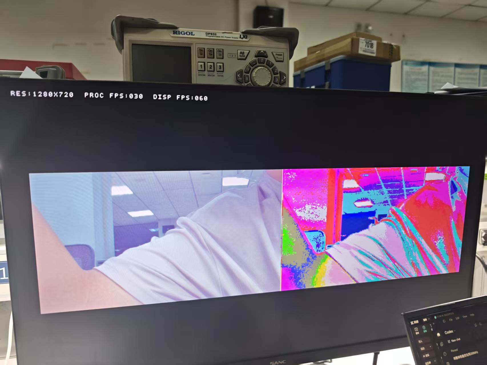

# 性能验证与复现

本目录提交当前最终五风格工程的实测数据、评估代码、对比结果及原始影像。首先阅读[性能实测与标准网络对比](性能实测与标准网络对比.md)。

## 1. 关键结果

|项目|结果|
|---|---|
|处理分辨率 / 推理完成速率|1280×720 / 30.010 fps|
|显示刷新率|60.003 Hz；与处理帧率分别计量|
|五风格切换|20种有向组合，各3次，60次均小于100 ms|
|切换平均 / P95 / 最大|64.034 / 78.790 / 81.446 ms|
|切换窗口连续性|采集、推理、新显示各3064帧，丢帧与画面异常计数无新增|
|板端任务|五风格各30次，共150次完成；平均33.480 ms|
|部署容量|每风格4 KiB，五风格总载荷20 KiB|
|有效卷积参数（含偏置）|A4学生1551；匹配TransformerNet教师1679235|
|20图同风格画质|平均PSNR 16.9134 dB，RGB SSIM 0.557636|
|定点与对应QAT参考|20/20逐像素一致|
|同GPU中位推理时延|A4 10.658 ms；匹配教师25.435 ms|

## 2. 板端采集

在项目根目录安装`02_网页应用/requirements.txt`或使用随附Windows依赖。连接摄像头、HDMI和板端USB串口，烧录`04_烧录文件/OSD_SIMPLE_SELECTED5_FULL_FLASH.hex`对应版本。关闭占用串口的软件及网页图片任务后执行：

```powershell
python 07_性能验证/tools/collect_board_metrics.py --port COM9 --out E:/measurements/camera
```

串口号按设备修改。脚本执行10秒基线、60次风格切换、60秒稳态采样和150次任务；结束恢复连续视频。已存在输出自动使用新目录保留旧数据。脚本不写Flash、不复位。可先加`--dry-run`查看操作范围。

`原始证据/result.json`、`switches.csv`、`tasks.csv`与`serial_log.txt`为原始采集文件；`现场录像.mp4`与`稳态显示照片.jpg`为动态显示和OSD佐证。

## 3. 标准网络对比复现

需要Python 3.10、NumPy、Pillow、PyTorch及可用CUDA设备。教师、学生和20张评估输入随包提供，完整训练数据集不是推理复现依赖。

```powershell
python 07_性能验证/tools/benchmark_matched_teacher.py --verify-only
python 07_性能验证/tools/benchmark_matched_teacher.py --output E:/measurements/teacher_replay
```

工具核对当前槽2、学生检查点重导出字节、教师哈希、评估输入哈希及其与训练/验证列表的无交集关系，再使用相同输入运行定点参考、QAT学生与匹配教师。20图比较采用640×480输入；5次预热、30次CUDA事件计时。`浮雕标准网络对比/REPORT.json`保留原始GPU时延样本、逐图指标与模型哈希。各机器重测时延可能变化。

提交包中的便携入口已完整复跑20图，逐图画质指标与原记录相同；复跑结果、五槽重建记录及Flash合成一致性见`复跑核验/`。

## 4. 计量口径

切换计时从板内请求风格变化到目标风格完整可见帧结束，采用160 MHz硬件周期计数，排除UART传输。板端任务时延包含CPU启动、调度与IRQ等待，精度1 ms。软件画质对比与GPU计时独立于720p板端任务计时，不据此计算跨平台加速倍数。

连续性结论对应102.124秒切换窗口；稳态58个快照首尾间隔59.814秒。显示累计计数在采样边界可相差0～1帧。画质指标比较当前浮雕槽与其匹配教师；官方Mosaic初始化输出仅为附加参考，不作为同风格优劣排名。评估代码中的SSIM采用RGB均值、11×11 Gaussian、sigma=1.5和有效内区。

## 5. 完整性检查

```powershell
python verify_submission.py
python 07_性能验证/tools/verify_evidence.py
```

项目`MANIFEST.json`与`SHA256SUMS.txt`覆盖本目录文件。原始记录保留其采集元数据，报告结论不以文件生成时间或路径代替技术证明。

## 6. 显示实拍



[查看现场动态录像](原始证据/现场录像.mp4)。网络逐图对比图见`浮雕标准网络对比/comparison_0.png`至`comparison_7.png`。
